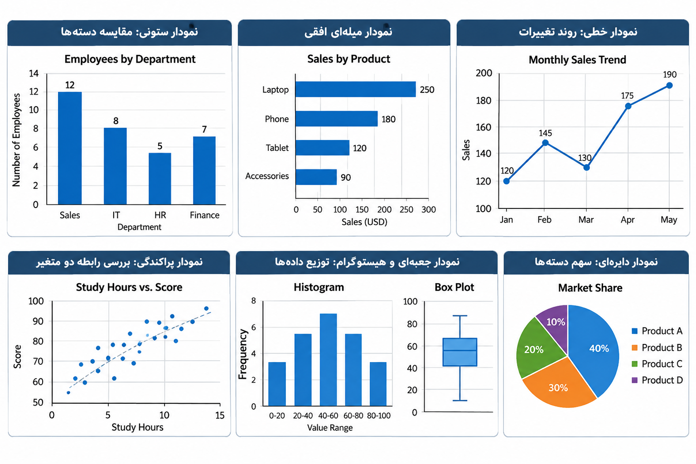

# بخش ۳ — مصورسازی داده‌ها (Data Visualization)

## اهداف یادگیری (Learning Objectives)

در پایان این بخش، می‌توانید:

- متناسب با سؤال تحلیلی خود، نمودار مناسب انتخاب کنید.
- روند تغییرات داده‌ها را در طول زمان نمایش دهید.
- مقادیر را بین دسته‌های مختلف مقایسه کنید.
- رابطه بین دو متغیر عددی را بررسی کنید.
- نمودارهای واضح، قابل‌فهم و مناسب برای گزارش‌های تحلیلی ایجاد کنید.
- اصول اولیه طراحی داشبورد (Dashboard) را در اکسل بشناسید.

---

## ۱. انتخاب نمودار مناسب برای سؤال تحلیلی (Choose a Chart for the Question)

انتخاب نمودار باید بر اساس هدف تحلیل انجام شود؛ یعنی ابتدا مشخص کنیم چه سؤالی داریم و سپس نموداری را انتخاب کنیم که پاسخ به آن سؤال را به بهترین شکل نمایش دهد.

| سؤال تحلیلی (Question) | نمودار پیشنهادی (Recommended Chart) |
|---|---|
| مقایسه مقادیر بین دسته‌های مختلف | Bar Chart / Column Chart |
| نمایش روند تغییرات در طول زمان | Line Chart |
| بررسی رابطه بین دو متغیر عددی | Scatter Plot |
| نمایش توزیع داده‌ها و شناسایی داده‌های پرت | Box Plot / Histogram |
| نمایش سهم هر دسته از کل مجموعه | Pie Chart (با احتیاط) |

### توضیح انواع نمودار

**الف) نمودار میله‌ای و ستونی (Bar / Column Chart)**

این نمودارها برای مقایسه مقادیر بین دسته‌های مختلف استفاده می‌شوند.

- `Column Chart`: میله‌ها به‌صورت عمودی نمایش داده می‌شوند.
- `Bar Chart`: میله‌ها به‌صورت افقی نمایش داده می‌شوند.

مثال: مقایسه تعداد کارکنان در واحدهای مختلف سازمان.

**ب) نمودار خطی (Line Chart)**

نمودار خطی برای نمایش روند تغییرات یک متغیر در طول زمان مناسب است.

مثال: بررسی تغییرات فروش ماهانه یک شرکت.

**ج) نمودار پراکندگی (Scatter Plot)**

این نمودار برای بررسی رابطه بین دو متغیر عددی استفاده می‌شود.

مثال: بررسی رابطه بین ساعات مطالعه و نمره دانش‌آموزان.

**د) نمودار جعبه‌ای (Box Plot) و هیستوگرام (Histogram)**

این نمودارها برای بررسی توزیع داده‌ها کاربرد دارند.

- `Histogram`: فراوانی داده‌ها را در بازه‌های مختلف نمایش می‌دهد.
- `Box Plot`: میانه، چارک‌ها، پراکندگی و نقاط بالقوه پرت را نشان می‌دهد.

**هـ) نمودار دایره‌ای (Pie Chart)**

نمودار دایره‌ای برای نمایش سهم دسته‌های مختلف از یک کل استفاده می‌شود.

این نمودار زمانی مناسب است که تعداد دسته‌ها کم باشد و مجموع مقادیر معنای مشخصی داشته باشد.

**نکته:** استفاده بیش از حد از نمودار دایره‌ای، به‌ویژه برای دسته‌های زیاد یا مقادیر نزدیک به هم، مقایسه را دشوار می‌کند.
---
** نمونه نمودارها **

---

## ۲. مثال کاربردی — بررسی فروش ماهانه (Worked Example: Monthly Sales)

فرض کنید اطلاعات فروش یک شرکت در پنج ماه متوالی به‌صورت زیر ثبت شده است:

| Month | Sales |
|---|---:|
| Jan | 120 |
| Feb | 145 |
| Mar | 130 |
| Apr | 175 |
| May | 190 |

### هدف تحلیل

بررسی روند تغییرات فروش از ماه ژانویه تا ماه می.

### مراحل ایجاد نمودار خطی

1. جدول داده‌ها را در اکسل وارد کنید.
2. محدوده جدول را انتخاب کنید.
3. از مسیر زیر وارد شوید:

   `Insert → Line Chart`

4. یک نمودار خطی مناسب انتخاب کنید.
5. عنوان نمودار را به شکل زیر تنظیم کنید:

   `Monthly Sales Trend`

6. عنوان محور افقی را `Month` قرار دهید.
7. عنوان محور عمودی را `Sales` قرار دهید.

### تفسیر نمودار (Interpretation)

بر اساس داده‌ها:

- فروش از ژانویه تا می در مجموع افزایش یافته است.
- فروش در ماه مارس نسبت به فوریه کاهش داشته است.
- بیشترین مقدار فروش در ماه می برابر با 190 است.
- کمترین مقدار فروش در ماه ژانویه برابر با 120 است.

**نکته تحلیلی مهم:** نمودار به ما کمک می‌کند روند داده‌ها را توصیف کنیم؛ اما به‌تنهایی علت افزایش یا کاهش فروش را مشخص نمی‌کند.

برای شناسایی علت تغییرات، به اطلاعات تکمیلی و تحلیل‌های بیشتر نیاز داریم.

---

## ۳. مثال کاربردی — مقایسه واحدهای سازمانی (Worked Example: Compare Departments)

فرض کنید تعداد کارکنان چهار واحد سازمانی به‌صورت زیر است:

| Department | Employees |
|---|---:|
| Sales | 12 |
| IT | 8 |
| HR | 5 |
| Finance | 7 |

### هدف تحلیل

مقایسه تعداد کارکنان در واحدهای مختلف سازمان.

### مراحل ایجاد نمودار ستونی

1. جدول داده‌ها را وارد اکسل کنید.
2. محدوده جدول را انتخاب کنید.
3. از مسیر زیر اقدام کنید:

   `Insert → Column Chart`

4. یک نمودار ستونی دوبعدی انتخاب کنید.
5. عنوان نمودار را به شکل زیر تنظیم کنید:

   `Number of Employees by Department`

### تفسیر نتایج

- واحد `Sales` با 12 کارمند بیشترین تعداد کارکنان را دارد.
- واحد `HR` با 5 کارمند کمترین تعداد کارکنان را دارد.
- واحدهای `IT` و `Finance` به‌ترتیب 8 و 7 کارمند دارند.

### اصول طراحی نمودار

- از جلوه‌های سه‌بعدی (3-D Effects) غیرضروری استفاده نکنید.
- عنوان نمودار باید روشن و مختصر باشد.
- محور نمودار باید مقیاس واقعی داده‌ها را نمایش دهد.
- در نمودارهای میله‌ای و ستونی برای مقایسه مقادیر، محور مقدار معمولاً باید از صفر شروع شود؛ زیرا شروع از مقدار دیگر می‌تواند تفاوت‌ها را بزرگ‌تر از واقعیت نشان دهد.

---

## ۴. مبانی داشبورد (Dashboard Basics)

داشبورد (Dashboard) یک صفحه مدیریتی است که شاخص‌ها و اطلاعات مهم را به‌صورت خلاصه و بصری نمایش می‌دهد.

یک داشبورد ساده در اکسل می‌تواند شامل اجزای زیر باشد:

### الف) جدول محوری (PivotTable)

برای خلاصه‌سازی داده‌ها و انجام تحلیل‌هایی مانند:

- تعداد کارکنان در هر واحد
- مجموع حقوق هر واحد
- میانگین حقوق کارکنان

### ب) نمودار محوری (PivotChart)

نموداری که بر اساس داده‌های PivotTable ایجاد می‌شود و امکان نمایش بصری خلاصه اطلاعات را فراهم می‌کند.

### ج) برش‌دهنده (Slicer)

ابزاری تعاملی برای فیلتر کردن داده‌ها در PivotTable یا PivotChart.

مثال: انتخاب واحد `Sales` از طریق Slicer برای مشاهده اطلاعات مربوط به کارکنان واحد فروش.

### د) شاخص‌های کلیدی عملکرد (KPIs)

شاخص‌های مهمی که در داشبورد نمایش داده می‌شوند.

برای مثال:

| KPI | مفهوم |
|---|---|
| Total Headcount | تعداد کل کارکنان |
| Average Salary | میانگین حقوق کارکنان |

**نکته:** داشبورد باید اطلاعات مهم را سریع و واضح نمایش دهد؛ بنابراین از نمودارها و عناصر تزئینی غیرضروری اجتناب کنید.

---

## ۵. تمرین‌های عملی (Practice)

### تمرین ۱ — مقایسه فروش

یک جدول فروش برای پنج محصول مختلف ایجاد کنید.

با استفاده از `Column Chart`، فروش محصولات را با یکدیگر مقایسه کنید.

### تمرین ۲ — نمایش روند زمانی

اطلاعات فروش یک شرکت را برای شش ماه وارد کنید.

با استفاده از `Line Chart`، روند تغییرات فروش را نمایش دهید.

### تمرین ۳ — بررسی رابطه دو متغیر

یک مجموعه داده شامل ساعات مطالعه و نمره دانش‌آموزان ایجاد کنید.

با استفاده از `Scatter Plot`، رابطه بین دو متغیر را بررسی کنید.

### تمرین ۴ — ایجاد داشبورد ساده

یک داشبورد ساده در اکسل طراحی کنید که شامل موارد زیر باشد:

- یک `PivotTable`
- یک `PivotChart`
- یک `Slicer` برای فیلتر کردن واحد سازمانی
- شاخص `Total Headcount`
- شاخص `Average Salary`

---

## ۶. نکات کلیدی (Key Takeaways)

- انتخاب نمودار باید متناسب با سؤال تحلیلی باشد.
- `Bar Chart` و `Column Chart` برای مقایسه دسته‌ها مناسب هستند.
- `Line Chart` برای نمایش روند تغییرات در طول زمان استفاده می‌شود.
- `Scatter Plot` برای بررسی رابطه بین دو متغیر عددی کاربرد دارد.
- `Histogram` و `Box Plot` برای بررسی توزیع داده‌ها استفاده می‌شوند.
- `Pie Chart` برای نمایش سهم دسته‌ها از یک کل مناسب است، اما باید با احتیاط استفاده شود.
- نمودار باید عنوان واضح، محورهای خوانا و مقیاس مناسب داشته باشد.
- نمودار، روند یا رابطه را نمایش می‌دهد؛ اما لزوماً علت آن را مشخص نمی‌کند.
- داشبورد با ترکیب PivotTable، PivotChart، Slicer و KPIها، اطلاعات مهم را به شکل خلاصه ارائه می‌کند.
